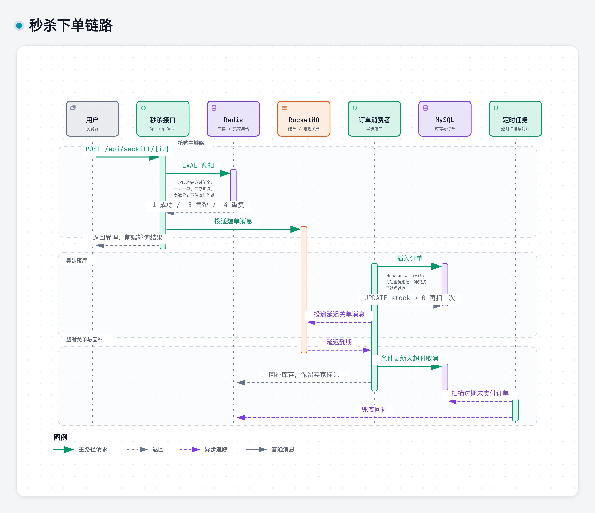
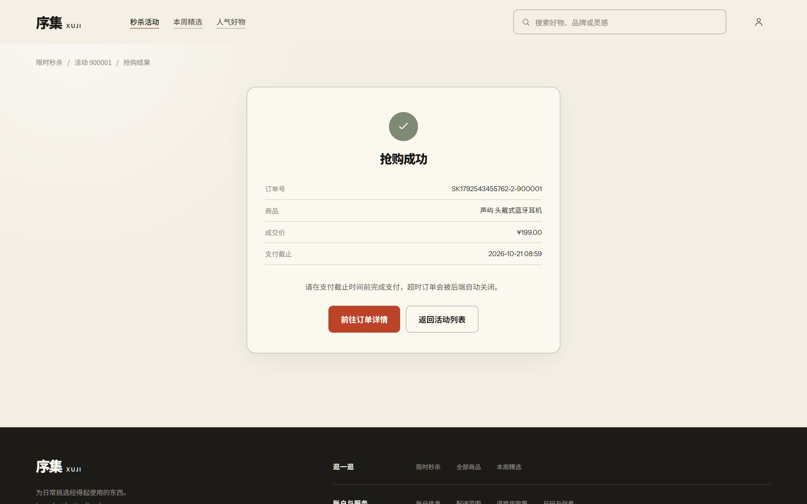
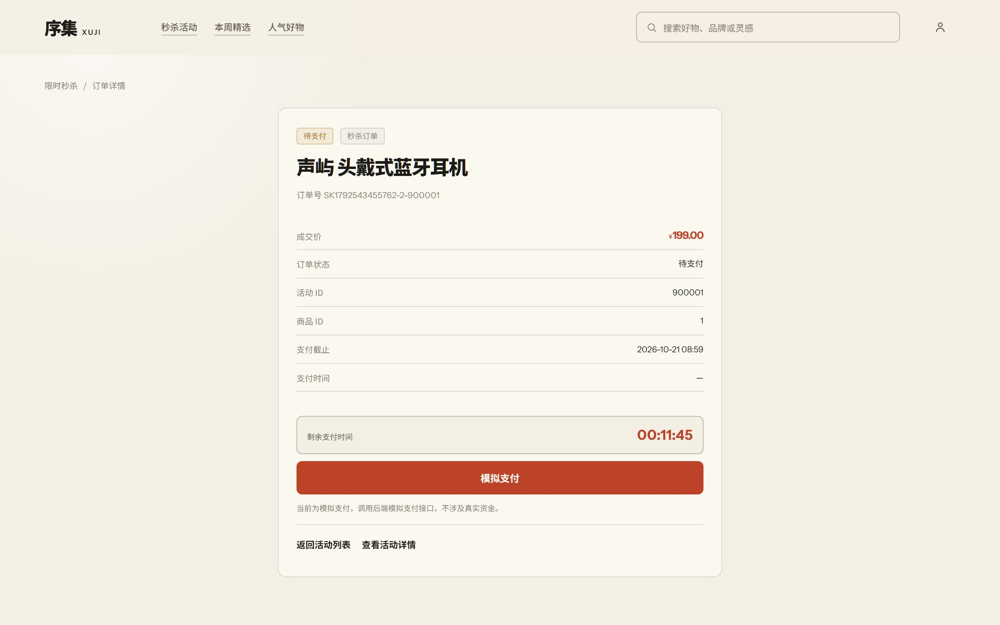
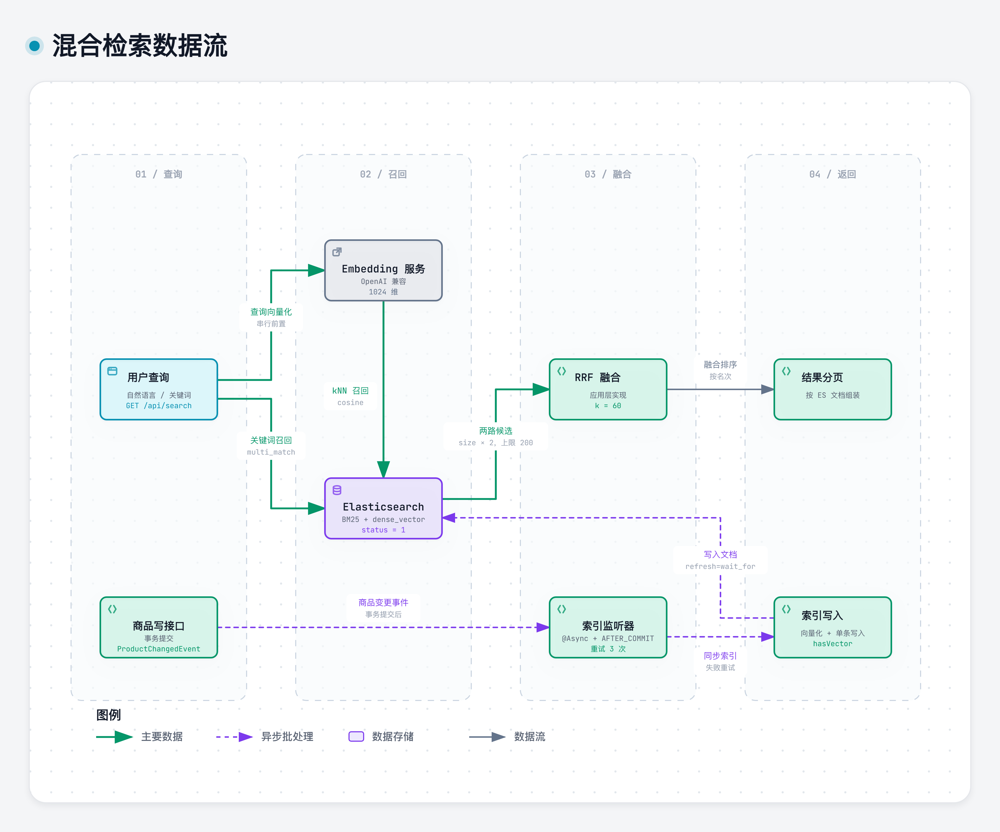
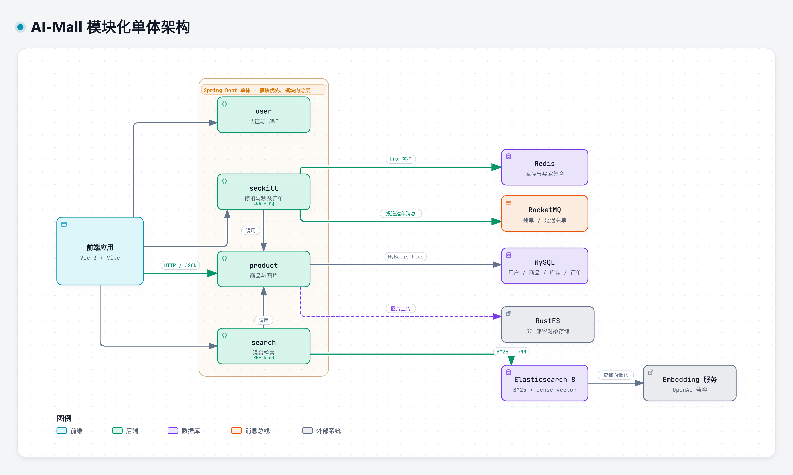
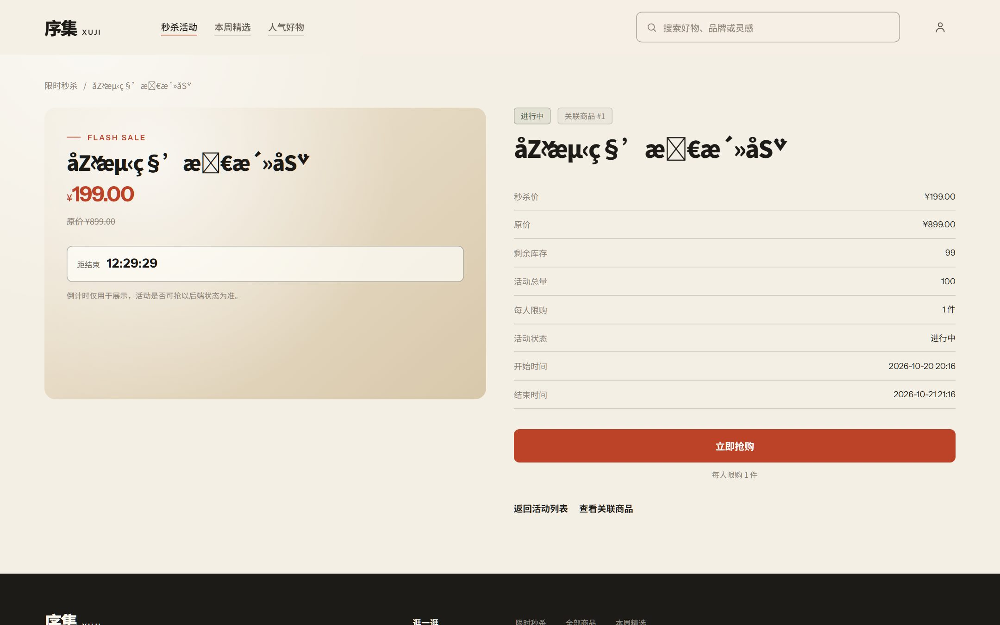
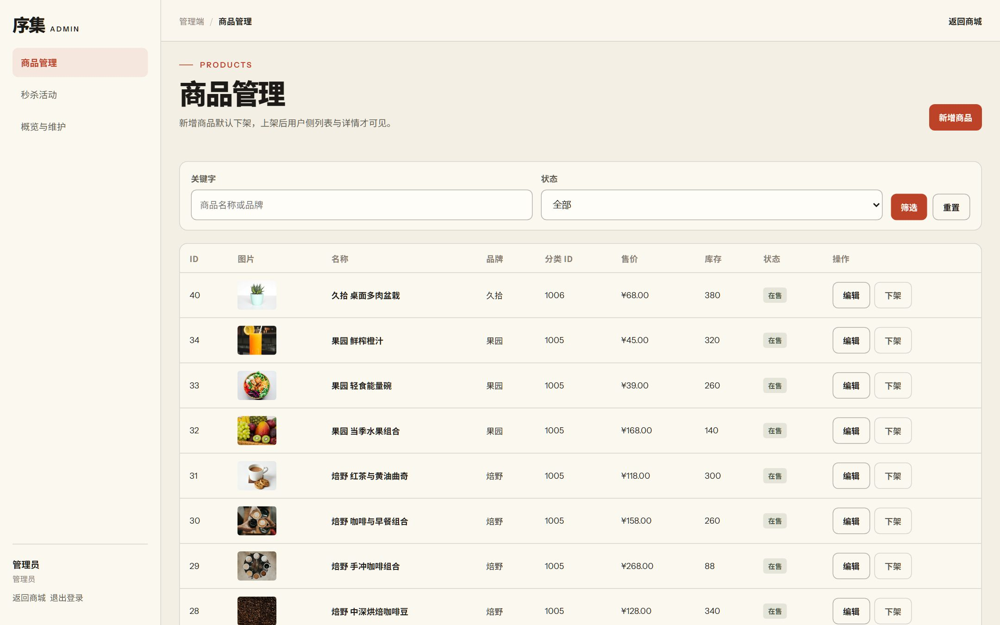
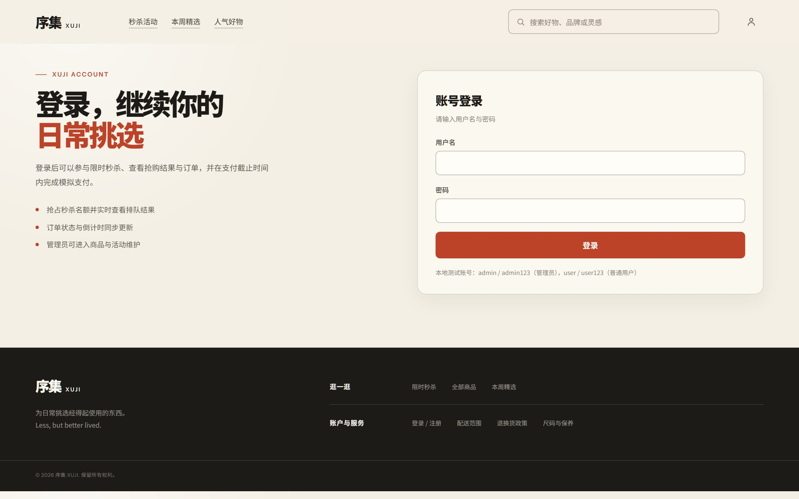

# AI-Mall

基于模块化单体架构的商城项目，包含用户认证、商品管理、秒杀活动与商品搜索四部分。
基础商城功能只作为承载，核心是两条链路：

- **高并发秒杀**：Redis Lua 预扣库存 + RocketMQ 异步下单 + 防超卖/幂等/超时回补
- **AI 混合搜索**：Elasticsearch BM25 + 向量语义检索 + RRF 融合排序


## 功能范围

| 模块 | 已实现 |
| --- | --- |
| 用户 | 登录、JWT 鉴权、角色区分（USER / ADMIN） |
| 商品 | 分页查询、详情、上下架、图片上传、后台增改查 |
| 秒杀 | 活动管理、库存预热、抢购、结果轮询、模拟支付、超时关单与库存回补 |
| 搜索 | 关键词与自然语言混合检索、索引异步同步、全量重建索引 |

前端为 Vue 3 + Vite 的单页应用，包含商城端与管理后台两部分。

## 秒杀链路

活动库存预热到 Redis。抢购请求由一段 Lua 脚本在 Redis 内一次性完成时间窗校验、用户去重与库存扣减，
成功后投递 RocketMQ 异步建单，接口立即返回而不等待数据库事务。



**请求路径**：一次 `EVAL` 完成全部判断，失败分支直接返回，不修改任何键；成功只投递消息，不等建单结果。
接口返回后前端轮询结果接口，订单落库即可查到。

**一致性兜底**：Redis 与数据库两侧都扣减，数据库约束是最后一道防线。
消费端落库时以 `UPDATE ... WHERE stock > 0` 再扣一次数据库库存，扣不动说明两侧不一致，抛出让消息重投；
`(user_id, activity_id)` 唯一索引兜住重复消息；表级 `CHECK (stock >= 0)` 使负库存写入被数据库直接拒绝。
Redis 键丢失时，库存对账任务会在活动结束后比对两侧并告警。

**回补闭环**：订单创建后投递延迟消息精确关单，另有分钟级定时扫描兜底消息丢失；
关单用条件更新流转状态，重复触发不会重复回补。回补库存时保留买家标记，一人一单终身有效，
避免「拍下不付款」反复占坑。消息投递失败立即回补 Redis 预扣，不出现「库存扣了但没有订单」的悬空状态。

| 抢购结果 | 订单详情 |
| --- | --- |
|  |  |

## 混合搜索

商品写入 Elasticsearch 时把「名称 + 品牌 + 分类 + 卖点 + 描述」向量化存入 `dense_vector` 字段。
检索时并发发起 BM25 关键词召回与 kNN 语义召回，两路结果按 RRF（`Σ 1/(k+rank)`，k=60）融合。



品牌型号这类精确查询靠 BM25 稳定命中，自然语言描述靠 kNN 召回语义相关商品。
两路各取 `size × 2` 的候选窗口（上限 200），只在一路出现的商品按单路得分参与排序。
融合在应用层完成：ES 原生 `rrf` retriever 属于铂金/企业版特性，basic 许可下会直接报错。

商品变更在数据库事务提交后异步同步索引，不把 embedding 与 ES 的写入延迟计入商品接口；
向量化失败写入 `hasVector=false`，该商品仍可被 BM25 召回，不阻断主流程。


## 架构总览



采用「模块优先、模块内分层」的单体结构，每个业务模块内部按需划分
`controller / service / mapper / entity / dto / mq / lua`。

- `entity` 不跨模块暴露，跨模块只经 DTO 或 service 方法协作
- `search` 与 `seckill` 依赖 `product` 的 DTO 和服务，反向无依赖
- 核心业务逻辑放在 service，controller 只做参数校验和响应组装
- 不为「看起来架构化」增加抽象层，基础功能保持薄

三张图都有可交互的 HTML 版本（`docs/diagrams/*.html`），克隆后本地打开可查看分步视图。

## 技术选型与取舍

| 决策 | 选择 | 不这么做会怎样 |
| --- | --- | --- |
| 架构形态 | 模块化单体，按业务域分模块 | 拆微服务要引入注册中心、网关、分布式事务，单人项目里成本远大于收益 |
| 秒杀削峰 | Redis 预扣 + MQ 异步建单 | 同步下单时每个请求都要竞争同一行库存锁，售罄流量全部打在数据库上 |
| 正确性归属 | 数据库约束做最终裁决 | 只靠 Redis 判重，键丢失或消息重投都会导致超卖或重复下单 |
| 向量融合 | 应用层实现 RRF | ES 原生 `rrf` retriever 属铂金/企业版特性，basic 许可直接报 `security_exception` |
| 双路召回 | BM25 与 kNN 都保留 | 只用 kNN 时品牌型号等精确词召回不稳，只用 BM25 时自然语言查询召回不足 |
| 索引同步 | 事务提交后异步执行 | 在请求事务内同步调用 embedding 与 ES，会把外部服务延迟计入商品写接口 |
| 对象存储 | RustFS，仅存商品图片 | MinIO 停止开源；不引入通用文件服务，避免为单一场景过度设计 |

## 压测结论

对照基线为 `0cd8aed`（最后一个纯数据库同步下单的提交），同机同参串行压测。
下表为 200 线程、多轮取中位数的结果。

| 指标 | 同步版 | 异步版 | 变化 |
| --- | --- | --- | --- |
| 售罄后入口吞吐 | 671 QPS | 1,829 QPS | 2.7× |
| 售罄后 P99 | 472 ms | 217 ms | −54% |
| 突发抢购 POST 平均 | 404 ms | 333 ms | −18% |
| 突发抢购 POST P99 | 641 ms | 642 ms | 持平 |

售罄场景的差距来自「把无效流量挡在数据库之外」：同步版每个打空枪的请求仍要开事务、
竞争同一行库存锁再回滚；异步版在 Redis 里就被 Lua 脚本拦下，根本不进数据库。
突发场景收益有限，因为请求路径缩短的只是建单事务，客户端建连成本没有变化。

每轮压测结束后核对正确性，两个版本结果一致：

```text
orders=100  distinct_users=100  duplicate_orders=0
db_stock=0  oversold=0  redis_stock=0  redis_matches_db=true
```

压测在单机完成：JMeter 与应用同机共享 32 核 CPU 与网络栈，中间件为单机 Docker 容器，
客户端建连速率约 1,700 QPS 即为上限。绝对值不可外推到其他环境，结论只用于同环境两版对照。
完整环境、方法与原始数据说明见 [压测报告](docs/压测报告.md)。

## 页面预览

| 商品列表 | 商品详情 |
| --- | --- |
|  |  |

| 秒杀活动 | 管理后台 |
| --- | --- |
|  |  |

| 登录 | 移动端首页 |
| --- | --- |
|  |  |

## 快速开始

### 环境要求

| 依赖 | 版本 |
| --- | --- |
| Java | 21 |
| Maven | 3.9+ |
| Docker Desktop | 支持 Compose v2 |
| Node.js | 20.19+（仅前端） |
| pnpm | 12+（仅前端） |

### 启动后端

以下命令均在 `backend/` 目录执行：

```bash
cd backend

# 1. 准备环境变量，按需填写 embedding 接口密钥
copy .env.example .env

# 2. 一键启动：构建应用、启动中间件、建表、初始化 RocketMQ 主题并启动应用
powershell -ExecutionPolicy Bypass -File start.ps1
```

`start.ps1` 支持两个参数：`-NoApp` 只启动中间件，`-ResetDb` 删除并重建 `mall` 数据库后启动。
首次启动会构建带 ik 分词插件的 Elasticsearch 镜像，耗时较长。

初始账号：`admin / admin123`（管理员）、`user / user123`（普通用户）。

### 启动前端

```bash
cd frontend
pnpm install
pnpm dev
```

默认访问 `http://localhost:5173`，后端地址由 `frontend/.env.example` 中的 `VITE_API_BASE_URL` 指定。

### 服务地址

| 服务 | 地址 |
| --- | --- |
| 前端 | http://localhost:5173 |
| Swagger UI | http://localhost:8080/swagger-ui/index.html |
| 健康检查 | http://localhost:8080/actuator/health |
| RocketMQ 控制台 | http://localhost:18080 |

### 测试

后端测试分为单元测试与集成测试，集成测试（`*IT`）基于 Testcontainers 拉起真实的
MySQL、Redis、RocketMQ 与 Elasticsearch：

```bash
cd backend
mvn test              # 单元测试
mvn verify            # 单元测试 + 集成测试
```

## 接口一览

| 方法 | 路径 | 权限 | 说明 |
| --- | --- | --- | --- |
| POST | `/api/auth/login` | 公开 | 登录并获取 JWT |
| GET | `/api/auth/me` | 登录 | 当前登录用户 |
| GET | `/api/products` | 公开 | 分页查询上架商品 |
| GET | `/api/products/{id}` | 公开 | 上架商品详情 |
| GET | `/api/search` | 公开 | 关键词 + 语义混合搜索 |
| GET | `/api/seckill/activities` | 公开 | 分页查询秒杀活动 |
| GET | `/api/seckill/activities/{id}` | 公开 | 秒杀活动详情 |
| POST | `/api/seckill/{activityId}` | 登录 | 抢购下单，Redis 预扣后立即返回 |
| GET | `/api/seckill/{activityId}/result` | 登录 | 轮询抢购结果 |
| GET | `/api/seckill/orders/{orderNo}` | 登录 | 查询秒杀订单 |
| POST | `/api/seckill/orders/{orderNo}/pay` | 登录 | 模拟支付回调 |
| POST | `/api/seckill/orders/{orderNo}/cancel` | 登录 | 取消未支付订单 |
| GET | `/api/admin/products` | ADMIN | 分页查询商品（含下架） |
| POST | `/api/admin/products` | ADMIN | 新增商品 |
| PUT | `/api/admin/products/{id}` | ADMIN | 编辑商品 |
| PATCH | `/api/admin/products/{id}/status` | ADMIN | 上架 / 下架 |
| POST | `/api/admin/products/images` | ADMIN | 上传商品图片 |
| POST | `/api/admin/search/reindex` | ADMIN | 全量重建商品索引 |
| GET | `/api/admin/seckill/activities` | ADMIN | 分页查询全部秒杀活动 |
| POST | `/api/admin/seckill/activities` | ADMIN | 创建秒杀活动 |
| PUT | `/api/admin/seckill/activities/{id}` | ADMIN | 编辑秒杀活动 |
| POST | `/api/admin/seckill/activities/{id}/preheat` | ADMIN | 预热活动库存 |

带权限的接口需携带 `Authorization: Bearer <token>`。业务码、错误处理与联调约定见
[接口文档](docs/接口文档.md)，接口定义以 Swagger UI 为准。

## 目录结构

```text
.
├── backend/
│   ├── src/main/java/com/mall/
│   │   ├── common/             # 统一返回体、异常、JWT、embedding 客户端
│   │   ├── config/             # MyBatis-Plus、Security、存储等配置
│   │   ├── user/               # 认证与用户
│   │   ├── product/            # 商品与图片
│   │   ├── seckill/            # 秒杀活动、预扣、订单、MQ
│   │   ├── search/             # BM25 + kNN 召回、RRF 融合、索引同步
│   │   └── order/              # 普通订单占位
│   ├── src/main/resources/
│   │   ├── lua/                # 库存预扣与回补脚本
│   │   └── es/                 # 商品索引 mapping
│   ├── src/test/               # 单元测试与 Testcontainers 集成测试
│   ├── docker/                 # 含 ik 分词的 ES 镜像、RocketMQ 配置
│   ├── sql/                    # 建表与初始化数据
│   ├── docker-compose.yml
│   └── start.ps1
├── frontend/
│   ├── src/
│   ├── public/images/products/ # 商品图
│   └── package.json
├── docs/                       # 方案、接口、压测、架构图与截图
└── README.md
```

## 文档

方案、接口契约、压测报告、架构图与过程记录都在 [`docs/`](docs/)，入口见 [文档索引](docs/README.md)。
